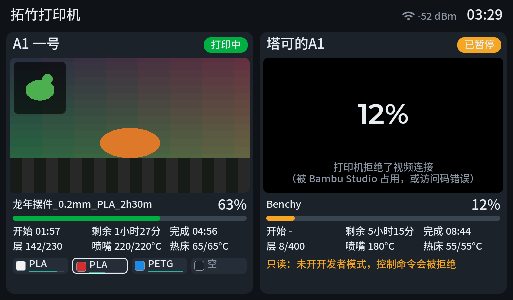
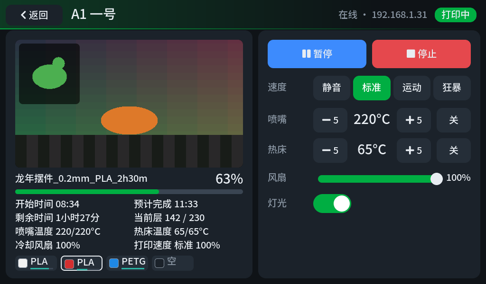
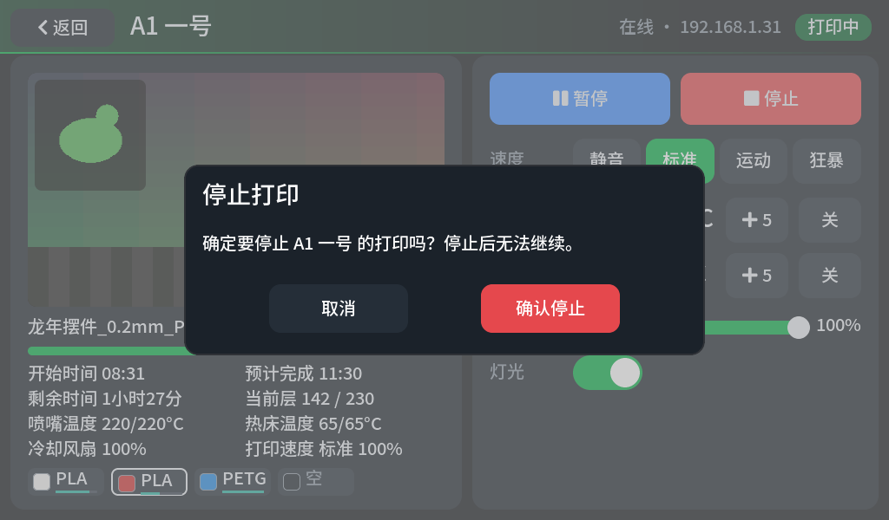
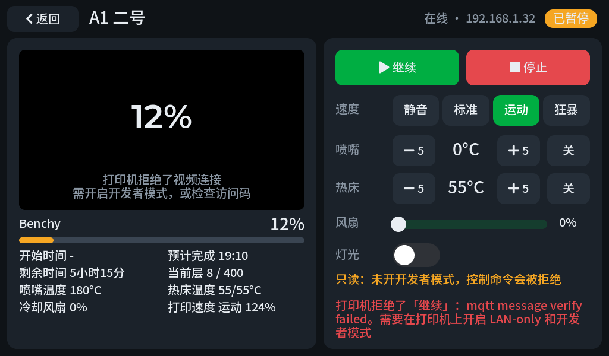
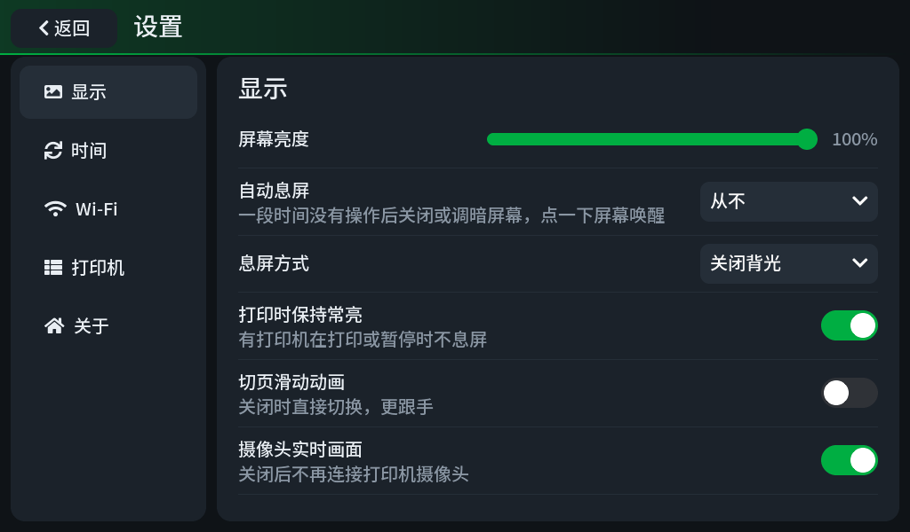
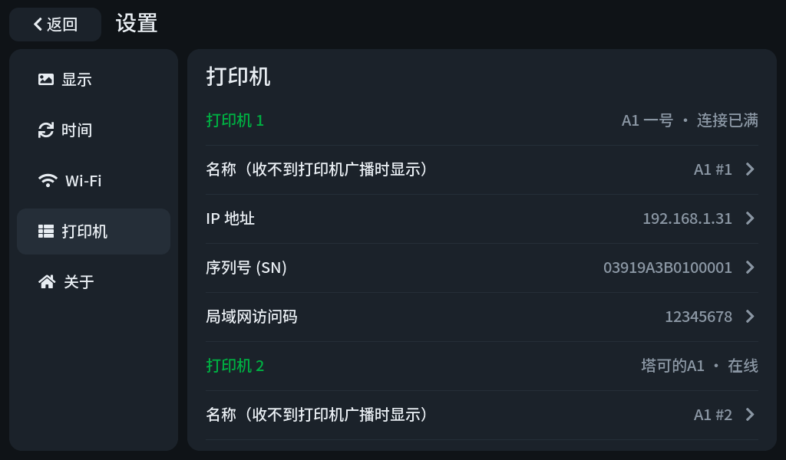
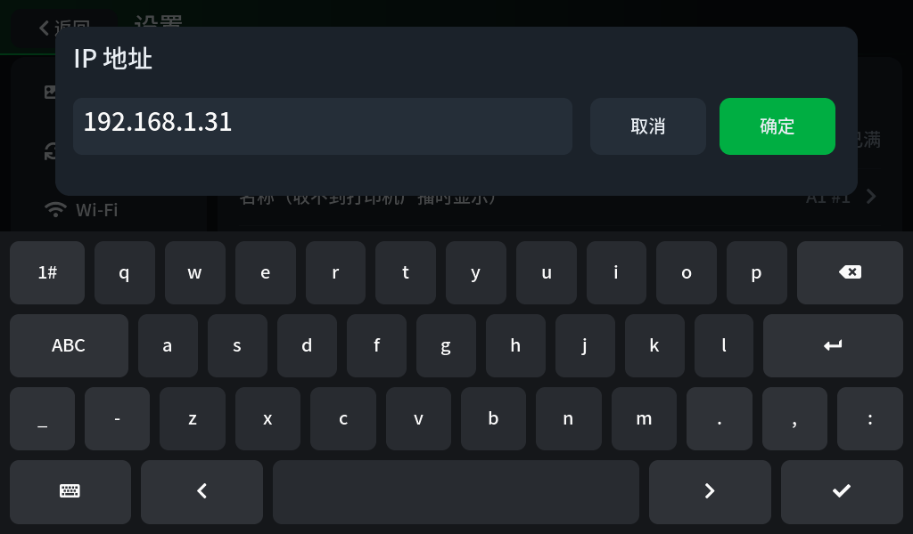

# esp32p4-bambulan：拓竹 A1 局域网状态 / 控制屏

用 ELECROW CrowPanel Advanced 7" ESP32-P4（1024×600 触摸屏，板载 ESP32-C6 做 Wi‑Fi）做的拓竹打印机无线屏。
通过局域网 MQTT（8883 端口，TLS）直连打印机，不经过拓竹云。



| 详情与控制 | 停止前二次确认 | 未开开发者模式时 |
|---|---|---|
|  |  |  |

| 设置：显示 | 设置：打印机 | 屏幕键盘 |
|---|---|---|
|  |  |  |

> 截图是在电脑上用同一份界面代码渲染的（`test/sim`），不是实拍。

## 功能（第一版）

- 两台打印机并排的概览页：摄像头实时画面、状态、任务名、进度条、开始时间 / 剩余时间 / 预计完成时间、层数、喷嘴/热床温度、AMS 料位（有料盘但没设耗材类型显示“未知”）和外挂料盘
- 模型预览图：经 FTPS（990 端口）只读取 3mf 末尾的 ZIP 目录和 `Metadata/plate_N.png` 一项，不下载整个文件，显示在画面左上角
- 摄像头：直连打印机 6000 端口取 JPEG 流，用 P4 的硬件 JPEG 解码 + PPA 缩放显示；没画面时显示大号进度和原因（固件 01.05 及以上需开开发者模式）
- 点卡片进详情页：暂停 / 继续、停止（二次确认）、四档调速、喷嘴和热床目标温度（±5 °C、关闭）、冷却风扇、灯光
- 显示打印机的命令回执；命令被拒时直接提示原因
- 自动识别打印机是否开启了开发者模式（`print.fun` / `flag3`），未开启时标记“只读”
- 断线自动重连，每 5 分钟、或 90 秒没收到消息时请求一次全量状态
- SNTP 对时（阿里云 NTP），显示时钟和预计完成时间
- 设置页（概览左上角“设置”）：亮度、自动息屏（打印状态变化时自动亮屏）、切页动画、摄像头开关、时区、
  Wi-Fi、打印机 IP / 序列号 / 访问码、重启和恢复默认。存在 NVS 里；menuconfig 的值只作为第一次开机的默认值
- 切页默认直接切换（滑动动画可在设置里打开）
- menuconfig「调试」里有：串口打印渲染耗时/帧率、自动来回切页、摄像头调试模式，默认全关

## 硬件

| 项 | 说明 |
|---|---|
| 主控 | ESP32-P4（32 MB PSRAM，16 MB Flash） |
| 屏幕 | 7" 1024×600 IPS，EK79007，MIPI‑DSI 2 lane |
| 触摸 | GT911，I2C SDA=45 SCL=46，RST=40 INT=42 |
| 背光 | GPIO31 PWM |
| Wi‑Fi | 板载 ESP32‑C6，SDIO（esp_hosted + esp_wifi_remote） |

板子有几个硬件版本，**先看板子背面丝印**：

| 丝印 | 编译方式 |
|---|---|
| V1.2 及以上（默认） | `idf.py build` |
| V1.1 | `idf.py -D SDKCONFIG_DEFAULTS="sdkconfig.defaults;sdkconfig.defaults.v1_1" build` |
| V1.0 | `idf.py -D SDKCONFIG_DEFAULTS="sdkconfig.defaults;sdkconfig.defaults.v1_0" build` |

区别在 ESP32‑P4 芯片版本、C6 复位脚和 SDIO 线数，参数取自 ELECROW 官方例程。切换版本前先删掉 `sdkconfig`。

板载 C6 需要跑 esp_hosted 的 slave 固件。出厂固件一般已经带了；如果 Wi‑Fi 起不来，按 ELECROW 仓库里的
“Upgrade P4 to C6 firmware” 说明刷一次。

## 编译与烧录

需要 ESP-IDF **v5.5.x**（开发时用 v5.5.4 验证通过）。

```bash
idf.py set-target esp32p4
idf.py menuconfig        # 进入「拓竹屏配置 (Bambu screen)」填写下面的参数
idf.py build flash monitor
```

menuconfig 里要填：

- Wi‑Fi SSID / 密码
- 每台打印机的 **显示名称、IP、序列号、局域网访问码**
- 时区（默认 `CST-8`）、屏幕亮度
- 「校验打印机 TLS 证书」默认打开；一直显示“TLS 失败”时可以先关掉
- 「RGB565 交换字节」默认关闭；如果屏幕颜色明显不对再打开

这些值存在 `sdkconfig` 里，已经被 `.gitignore` 忽略，不会提交到仓库。

也可以不进 menuconfig：把 `sdkconfig.defaults.local.example` 复制成 `sdkconfig.defaults.local` 填好，
编译时会自动叠加（同样被 `.gitignore` 忽略）。改了它之后要删掉 `sdkconfig` 再编译。

序列号和访问码在打印机屏幕上看：设置 → WLAN/网络（访问码）、设置 → 设备信息（序列号）。
IP 建议在路由器里给打印机绑定成固定地址。

## 关于开发者模式（A1）

- 拓竹在 A1 固件 **01.05.00.00** 加入了“授权控制”和开发者模式。
- 低于这个版本（比如 01.04）：没有限制，局域网 MQTT 可以直接读状态和发控制命令，不用开任何东西。
- 01.05 及以上（比如 01.07）：不开开发者模式时，第三方只能读状态，暂停/停止/调温等命令会被打印机拒绝。
- 开启方法：打印机上 **设置 → WLAN/网络 → 打开“仅局域网（LAN‑only）”**，重启一次，同一菜单里才会出现 **开发者模式** 开关。
- 开 LAN‑only 后打印机会断开拓竹云，Bambu Handy 不能再用，也收不到云端固件推送。
- A1 的局域网访问码在开了 LAN‑only 后才显示；如果显示全是 0，关掉 LAN‑only 再打开一次。

屏幕会根据打印机上报的标志判断是否需要开发者模式，命令被拒时也会在详情页提示。

## 目录

```
main/
  main.c            启动流程
  board.c           屏幕 / 触摸 / 背光（EK79007 + GT911 + esp_lvgl_port）
  net.c             Wi‑Fi（经 C6）+ SNTP
  bambu/
    bambu_parse.c   MQTT 报文解析（增量合并，纯 C，可在电脑上测）
    bambu_cmd.c     控制命令拼装
    printer.c       每台打印机一个 MQTT/TLS 连接
    camera.c        摄像头取流（TLS 6000）+ 硬件 JPEG 解码 + PPA 缩放
    cover.c         模型预览图（FTPS 990，按需读取 3mf 里的 PNG）
  ui/ui.c           LVGL 界面
  ui/fonts/         生成好的中文字体（Noto Sans SC，含 GB2312 一级常用字）
  certs/bambu_ca.pem 拓竹打印机 CA（来自 ha-bambulab，MIT）
test/host/          解析器单元测试：make -C test/host
test/sim/           在电脑上渲染界面截图
tools/gen_fonts.py  重新生成字体（改了界面文字后运行）
```

## 在电脑上测试

```bash
# 报文解析和命令拼装
make -C test/host IDF_PATH=~/esp/esp-idf

# 渲染界面截图（需要 LVGL v9.2.2 源码）
cmake -S test/sim -B build-sim -DLVGL_DIR=/path/to/lvgl -DCJSON_DIR=$IDF_PATH/components/json/cJSON
cmake --build build-sim && (cd build-sim && ./sim)
```

## 参考与许可

- 本项目 MIT 许可。
- 协议细节参考了 [ha-bambulab](https://github.com/greghesp/ha-bambulab)（MIT，CA 证书和测试数据也来自它）。
- 屏幕时序和引脚参考 ELECROW 官方例程。
- 字体：Noto Sans SC、Montserrat，均为 SIL Open Font License。
- 没有使用 xtouch（GPL）或 KSDIY‑F101（无许可证）的代码。

## 刷屏方式（实测定下来的，不要改）

这块屏（V1.0 板实测）对刷新方式很敏感，改错了整屏亮度会肉眼可见地闪：

- **必须**和 ELECROW 官方例程一致：LVGL 局部渲染（PARTIAL）+ 1 块 DPI 帧缓冲（`num_fbs = 1`）+ 不开 `avoid_tearing`，背光默认 100%。见 `main/board.c`。
- **不要**用 `direct_mode` + 2 块帧缓冲 + `avoid_tearing`（vsync 换缓冲）：录像测得整屏亮度抖动约 ±3%，背光开满也一样。
- **不要**加一直在跑的动画（呼吸灯、循环动效等），界面只在内容变化时局部刷新。定时刷新里给控件设值时要先比较，值没变就不要调 LVGL 的 set 函数（`lv_obj_set_style_*`、`lv_obj_align*` 即使值相同也会让该区域重画）。模拟器 `test/sim` 会检查静止 2 秒内的重画次数，应为 0。
- 右下角小字（设置里可关）：FPS 是最近 1 秒真正重画的帧数，界面不动时应为 0；1% low 是最近 256 帧中最慢 1% 的帧耗时换算的帧率；CPU 是两个核各自的占用。
- 整屏滑动切页每帧要整屏重画 35~50ms（只有 18~23fps），所以默认关闭。

